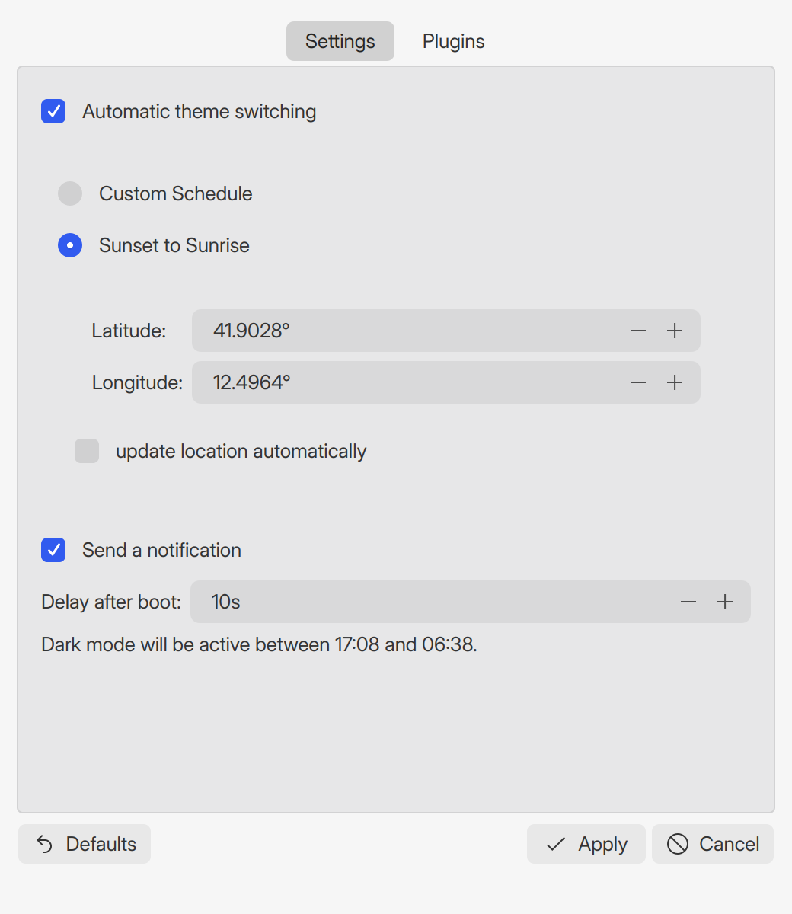
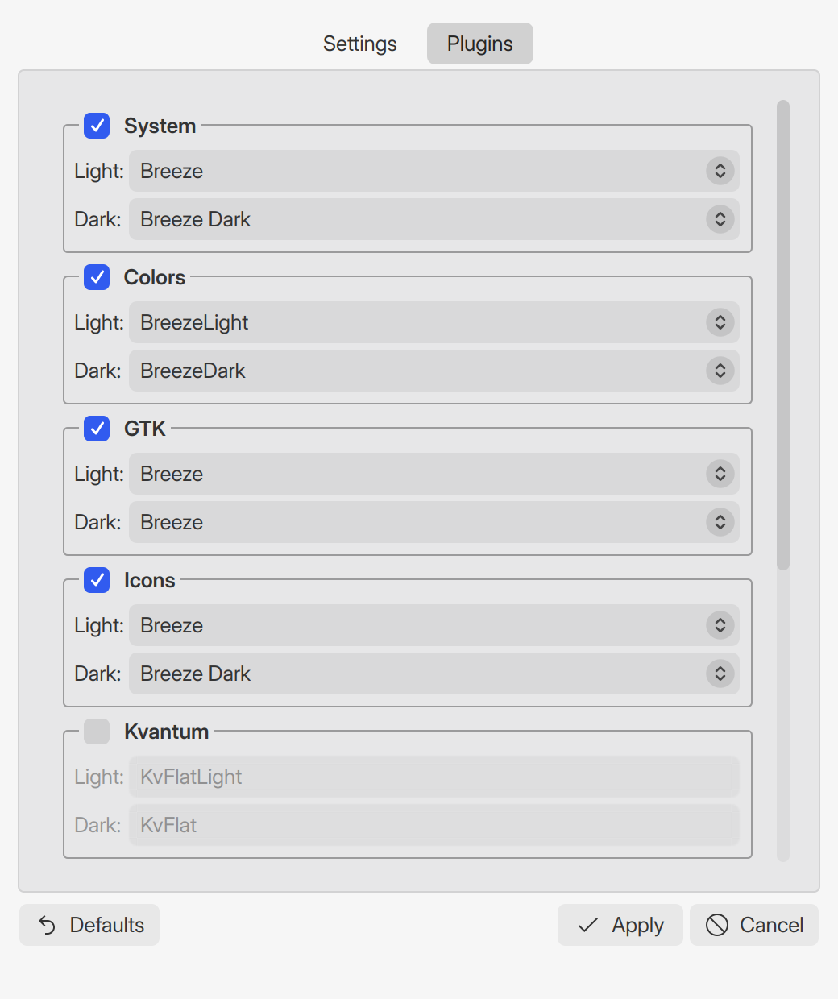

<div align="center">


# Yin-Yang

**Light and dark themes for KDE Plasma, switched for you.**<br>
By the clock or by the sun, across the desktop, your apps and your editor — in one step.

[](https://github.com/Techttv/Yin-Yang-Rust/releases)
[](LICENSE)


<br>

 &nbsp;


</div>

<br>

## Why

[Yin-Yang](https://github.com/oskarsh/Yin-Yang) does this job well, but it is a Python program that runs
from your `PATH`: one Python or library update later, the timer fails silently and your desktop stays
in the wrong theme. **yinyang** is a native rewrite for KDE Plasma 6 with nothing to break:

- 🦀 **A single Rust binary** for everything that matters — it links only against glibc and libgcc, no Python at runtime.
- 🪟 **A Qt 6 window that looks like Plasma**, because it is drawn by your Plasma theme, not by a custom style.
- ⏱️ **A systemd user timer** that catches up after sleep or a missed switch, and retries if the session
  is not ready yet at login.
- 🧩 **12 plugins**, each with its own light and dark choice, and each failing on its own: one broken
  plugin never stops the others.
- 🛡️ **Edits files carefully.** VS Code's `settings.json` keeps its comments and trailing commas; only the
  theme value changes. Files it edits are replaced atomically, keeping their permissions and symlinks.

## Install

Arch Linux, KDE Plasma 6, x86_64. The package is managed by `pacman` like any other: no AUR, AppImage
or Flatpak.

### From a release (fastest)

Download `yinyang-<version>-1-x86_64.pkg.tar.zst` from the
[latest release](https://github.com/Techttv/Yin-Yang-Rust/releases/latest), then:

```sh
sudo pacman -U yinyang-*-x86_64.pkg.tar.zst
```

The release package is built against current Arch Qt 6. If `yinyang-gui` ever fails to start after a Qt
major update, build it yourself as below.

### From source

```sh
git clone https://github.com/Techttv/Yin-Yang-Rust.git
cd Yin-Yang-Rust/packaging/arch
makepkg -si
```

`-s` installs the build dependencies (`rust`, `cmake`, `qt6-tools`). The build runs the whole test suite
(about four minutes the first time). To update: `git pull`, then the same `makepkg -si`.

### Remove

```sh
systemctl --user disable --now yinyang.timer
sudo pacman -R yinyang
```

## Get started

The package never starts a timer by itself. Open **Yin & Yang** from the application menu, pick a mode,
enable the plugins you want and press **Apply**: that saves your settings, switches to the theme that
is due now and (re)creates the timer. From a terminal:

```sh
yinyang plugins                          # what is available on this machine (JSON)
yinyang apply --dark --force --dry-run   # show what a switch would do, without doing it
yinyang apply --light                    # switch now
yinyang timer refresh                    # (re)create and start the timer from the config
```

Coming from the original Yin-Yang? Your old settings are imported on first run (the old file is never
modified). See [docs/MIGRATING.md](docs/MIGRATING.md) for the switch-over and how to roll back.

## Modes

| Mode | Switches |
| --- | --- |
| **Manual** | Never on its own. The **Light** and **Dark** buttons and the tray icon switch on demand. |
| **Custom schedule** | At two times you choose, every day. |
| **Sunset to sunrise** | At the local sunrise and sunset, recomputed on every run so it follows the seasons. The position comes from your settings, or from [ipinfo.io](https://ipinfo.io) if you enable *update location automatically*; the last known position is kept, so being offline never makes it guess. |

The tray icon opens the window on a left click and flips the theme on a middle click.

## Plugins

| Plugin | What it switches | Needs |
| --- | --- | --- |
| **System** | The Plasma global theme (look and feel) | `plasma-workspace` |
| **Colors** | The colour scheme | `plasma-workspace` |
| **GTK** | The GTK theme, so GTK apps match | `kde-gtk-config` |
| **Icons** | The icon theme | `plasma-workspace` |
| **Kvantum** | The Kvantum widget theme | `kvantum` |
| **Wallpaper** | The desktop wallpaper | Plasma |
| **VS Code** | `workbench.colorTheme`, comments and formatting untouched | VS Code |
| **OnlyOffice** | The OnlyOffice interface theme | OnlyOffice |
| **Okular** | Okular's colour mode | `okular` |
| **Konsole** | The Konsole profile's colour scheme, in open windows too | `konsole` |
| **Custom** | Any shell command you write, one for light and one for dark | — |
| **Notification** | A desktop notification when the theme changes | — |

A plugin whose tool is not installed simply does not appear. Firefox and Zen need no plugin: their
default theme already follows the system through the `org.freedesktop.appearance` portal, so it changes
together with Plasma.

## Command line

| Command | Does |
| --- | --- |
| `yinyang apply [--auto \| --dark \| --light] [--force] [--dry-run]` | Apply a theme to every enabled plugin; this is what the timer runs. |
| `yinyang toggle` | Switch to manual mode and flip between light and dark. |
| `yinyang status` | Current state, switch times and location, as JSON. |
| `yinyang plugins [--json]` | Plugins, availability and themes. |
| `yinyang config show [--defaults]` / `config save` | Read the configuration (or the defaults) / replace it from stdin. |
| `yinyang timer refresh` | Rewrite and restart the systemd user timer from the configuration. |

The configuration lives in `~/.config/yinyang.json` and the timer units in
`~/.local/share/systemd/user/`. The GUI never edits the configuration itself: it only calls the
commands above, so the file format is defined in exactly one place.

## How it works

`yinyang apply --auto` is run by `yinyang.service`, started by `yinyang.timer` at the two switch times,
shortly after login (the *delay after boot*), and right away if a switch time passed while the computer
was off. A run only saves the new state if every plugin succeeded, so a failed one is tried again next
time. Each external program gets 60 seconds and each D-Bus call 25, so a hung desktop service cannot
block the timer. If the Plasma session is not up yet, the run exits with status 75 and the service
restarts it 20 seconds later, up to five times.

The design and its decisions are written down in [docs/design.md](docs/design.md).

## Development

```sh
cargo test                                     # core: unit and integration tests
cmake -S gui -B gui/build && cmake --build gui/build
QT_QPA_PLATFORM=offscreen ctest --test-dir gui/build --output-on-failure
```

The core lives in `src/`, one module per plugin in `src/plugins/`; the Qt GUI in `gui/`; the Arch
package in `packaging/arch/`.

## Credits and license

yinyang is a rewrite of [Yin-Yang](https://github.com/oskarsh/Yin-Yang) by Oskar Schachtschneider, later
maintained by L0drex, and its contributors. It follows that program's behaviour and reuses its
translations (German, Dutch, Chinese), icon and window layout. This project is independent: it is not
affiliated with or endorsed by the original authors.

Released under the [MIT license](LICENSE): copyright (c) 2019 Oskar Schachtschneider and
(c) 2026 Techttv.
